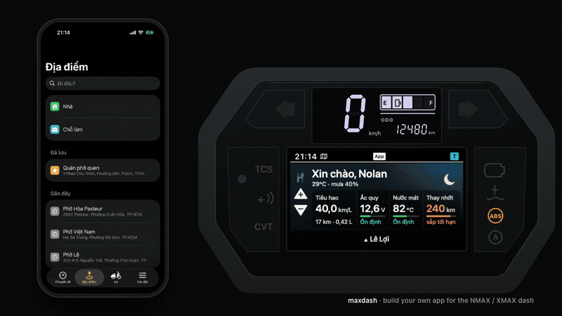

# maxdash

The first part is the author's own app (Vietnamese UI, real frames from its renderer); the end shows the
maxdash templates you start from.

**Build your own phone app for the Yamaha NMAX / XMAX TFT dash: your map, your design, with an AI agent
doing the coding.** Docs on how the dash and the bike talk to a phone, test vectors, HTML/CSS templates, and
an agent skill that walks you through it, even if you have never written code.

> Unofficial. Not affiliated with, endorsed by, or connected to Yamaha Motor or Garmin.

## Start here

**Quickest:** open an AI coding agent (Claude Code, Codex, Cursor, Antigravity, or similar) in an empty folder
on your computer and paste:

> Clone https://github.com/lntvan166/maxdash, read its AGENTS.md and help me build my own dash app.

Any language works. **Or by hand:**

1. Download this repository (green **Code** button › **Download ZIP**, then unzip), or `git clone` it.
2. Open the folder in your AI coding agent.
3. Say: **"Help me build my own dash app."**

It has to be a coding agent that can work with files on your computer. A chat in a web browser alone cannot
build and install an app.

The agent asks about your phone, your computer and what you want, shows you the templates, lets you pick
how maps and routes work, builds the app with you and walks you through installing it. The first goal: share
a place from Google Maps, and a turn-by-turn map shows up on your dash.

You need: the bike, an iPhone or an Android phone, a computer (Mac, Windows or Linux), and an evening.

## Does it work on my bike?

| Bike | Dash part | Screen | Phone | Status |
|---|---|---|---|---|
| NMAX Turbo / Tech MAX | `006-B3952-01` | 480×234 | iPhone | **Tested** (2026-10-24): map, buttons, street name, speed sign, bike data |
| XMAX, other NMAX years | `006-B4160…` and others | 480×240? | — | Not yet tested here. [Tell us!](CONTRIBUTING.md) |
| Any | — | — | Android | Experimental: documented, not yet tested here |

Tried it on your bike? Even "nothing happened" helps: [send a bike report](CONTRIBUTING.md).

## What's inside

| Folder | What |
|---|---|
| [docs/protocol/](docs/protocol/README.md) | How the phone talks to the dash (Link A) and the connectivity unit (Link B), every fact labelled *observed*, *documented* or *assumed* |
| [docs/how-it-works/](docs/how-it-works/overview.md) | The big picture, the dash canvas, the connection lifecycle, background running, routing and map options |
| [docs/build/](docs/build/ios-mac.md) | Building and installing: iPhone + Mac, iPhone + Windows, Android |
| [vectors/](vectors/README.md) | Exact bytes your app must produce: your code passes these before you ride |
| [templates/](templates/index.html) | Dash and phone screens in plain HTML/CSS, and the NMAX cluster drawn around the dash ([cluster/preview.html](templates/cluster/preview.html)): a starting design to keep or change |
| [AGENTS.md](AGENTS.md) | The agent skill (Claude Code also finds it as `.claude/skills/maxdash`) |

There is no app code here, on purpose: your agent writes *your* app, in your own folder. An iOS starter app
is planned for v2.

## Prior art

The Android app `pillion` showed that the same dash can be driven from an Android phone over Bluetooth
Classic. Its findings are restated here in our own words where they are used.

## Where the facts come from

Compiled by the author from public information on the internet, then tested on the author's NMAX Turbo.
Every claim carries its source label; when a bike disagrees with the docs, the bike wins and the docs change.

## Contributing

Protocol findings are the most wanted: the more bikes tested, the clearer the protocol for everyone. Bike
reports, fixes, new designs: see [CONTRIBUTING.md](CONTRIBUTING.md).

## Contact

**Please open a [GitHub issue](https://github.com/lntvan166/maxdash/issues/new/choose)** for bike reports, findings,
questions and ideas: everyone can see and build on the answer. Not on GitHub? Message
[@nolan166 on Telegram](https://t.me/nolan166).

## Licence

Docs and vectors: [CC BY 4.0](docs/LICENSE). Templates, tools and the agent skill: [MIT](LICENSE).
