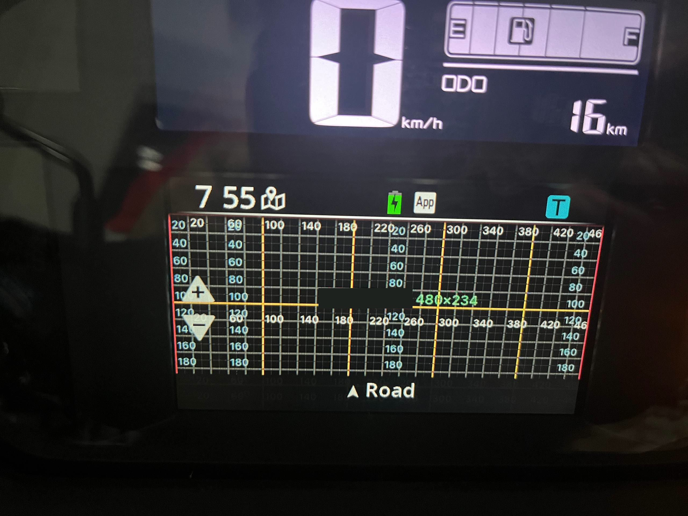

# The dash canvas

What your JPEG frame covers, and what the dash draws on top of it.

| Dash part (from cmd 83) | Frame size | Source |
|---|---|---|
| `006-B3952-01` (NMAX Turbo / Tech MAX) | 480×234 | observed (bike test 2026-10-24) |
| `006-B4160…` | 480×240 | documented — not yet observed |

- Pixels are frame pixels, origin top left, y down. The **whole frame is visible**, edges included.
- The dash's status row (clock, phone battery, icons) sits **above** the frame. You cannot draw there and
  it never covers your pixels.
- For a 480×240 dash, assume the same chrome as below until someone measures it.

## What the dash draws over your frame

| Element | Where (480×234) | Look | Source |
|---|---|---|---|
| ＋ zoom button | triangle pointing up: apex (29, 68), base y 99.5 from x 9 to 49 | opaque near-white `#F4F4F4`, dark glyph `#1E1E1E` | observed (bike test 2026-10-24) |
| － zoom button | triangle pointing down: base y 116 from x 9 to 49, apex (29, 147.5) | same | observed (bike test 2026-10-24) |
| Road bar | y 188 to the bottom, full width | black ~62 %, `▲ <text>` centred in white, ~20 px semibold; shows `Road` until you send text (cmd 3) | observed (bike test 2026-10-24) |
| Speed-limit sign | centre (442, 166), radius 31 (x 411–473, y 135–197) | red ring, white disc, black number; only while you send a limit (cmd 17) | observed (bike test 2026-10-25) |

Overlays to put on top of your mockups (480×234, transparent):

| File | What |
|---|---|
| [assets/chrome-overlay.png](assets/chrome-overlay.png) | Only what the dash draws: zoom buttons, road bar with a sample name, the sign |
| [assets/template.png](assets/template.png) | The chrome over a 10 px grid, with the no-text zones outlined |

## Safe area

Your map (roads, route) may run under the buttons and the bar. Keep **text, icons, signs and notices** out of:

| Zone | Rect (x, y, w, h) |
|---|---|
| Zoom buttons | (0, 68, 56, 100) |
| Road bar | (0, 186, 480, height − 186) |
| Speed sign, when you use it | (411, 135, 62, 62) |

Free areas worth using: the strip above the ＋ button (y < 64), the whole right half above the bar, and the
centre.

## Drawing for this screen

| Rule | Why |
|---|---|
| Text ≥ 16 px, semibold for anything read while riding | Read at a glance from riding position |
| Flat colours, no gradients, no textures, no noise | The JPEG must stay around 5–8 KB to reach ~4 fps (see [flow control](../protocol/link-a-dash.md#flow-control-and-speed)) |
| Thin saturated lines ≥ 3 px | 4:2:0 JPEG halves colour resolution; thin red/amber lines stair-step |
| A night and a day palette | Black ground at night, light ground by day; switch on sunrise/sunset |
| One accent colour for the route | The route must pop at a glance |

The [templates](../../templates/) follow these rules.
