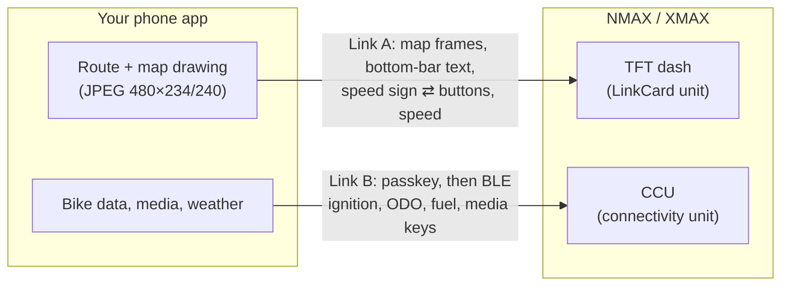

# How it works

Your phone app talks to the bike over two separate links. You only need **Link A** to put a map on the dash.

| Link | Carries | Transport | Needed for the first milestone? |
|---|---|---|---|
| **A: dash** | Phone → dash: JPEG map frames, bottom-bar text, the dash's own speed-limit sign. Dash → phone: handlebar UP/DOWN, bike speed, Home / pause. | iPhone: ExternalAccessory `com.garmin.navilite.data`. Android: Bluetooth Classic SPP (experimental). | **Yes** |
| **B: CCU** | Ignition on/off, ODO, battery voltage, coolant, fuel used; documented: media keys, track info, time, language, weather. | MFi `com.yconnect.data` for a passkey, then BLE. | No |

Details: [link-a-dash.md](../protocol/link-a-dash.md), [link-b-ccu.md](../protocol/link-b-ccu.md).

## What your app does, in one loop

1. Get a destination (a place shared from Google Maps, see [routing-options.md](routing-options.md)).
2. Get a route (MapKit, OSRM/Valhalla, or Google, your choice).
3. Track the rider's position (GPS).
4. Draw the dash picture: map around the rider, the route, the next turn. Draw it **on the CPU** into a
   480×234 (or 480×240) bitmap, encode a JPEG of about 5–8 KB.
5. Send it as a map frame, wait for the dash's ACK, repeat. About 4 frames per second looks smooth.
6. Keep the dash's bottom bar (street name) and speed sign up to date with small commands.

More: [lifecycle.md](lifecycle.md) (connect to ignition off), [dash-canvas.md](dash-canvas.md) (what you can
draw where), [background.md](background.md) (keeping it running in a pocket).
